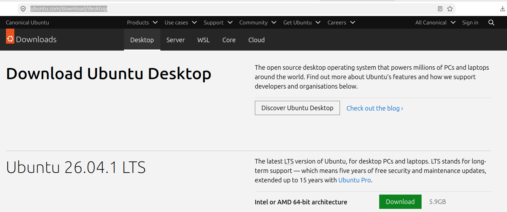
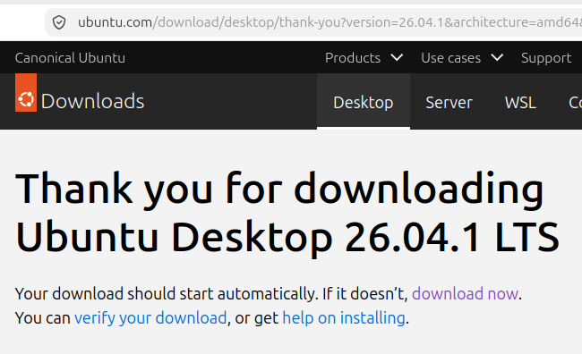
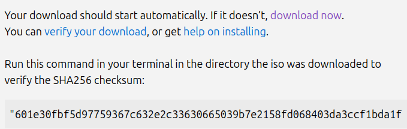
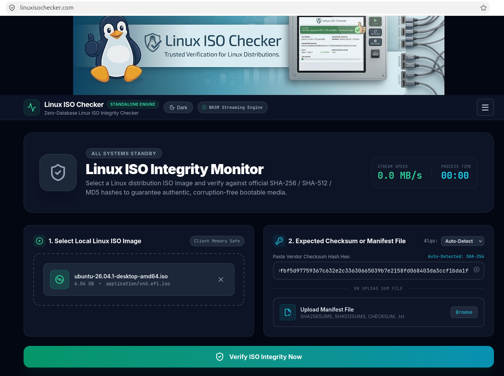
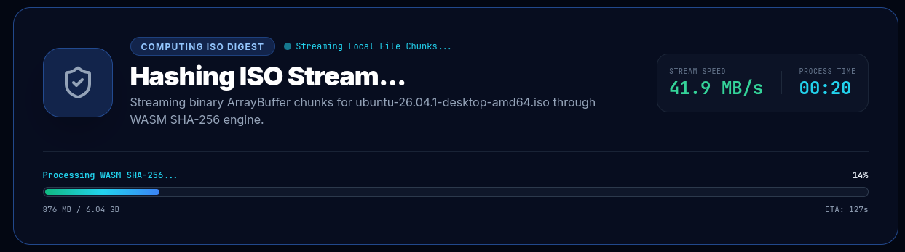
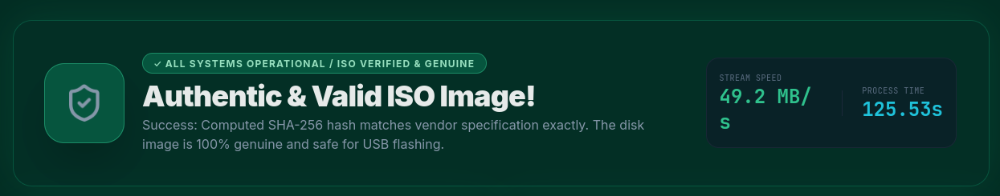

# How To Install Ubuntu With Encryption

This guide will show you how to install Ubuntu securely by encrypting the drive to protect from physical threats and enable the firewall to prevent online attacks.

[Click here for a full video guide](https://youtu.be/5_OtM5ggzYM)

## Pre-requisites

You will need a drive with Ventoy installed.

[Click here for a guide showing how to create a Ventoy drive](../ventoy-usb-creation-guide)

## Download and Create Ubuntu USB Drive

Go to [https://ubuntu.com/download/desktop](https://ubuntu.com/download/desktop)

Click on the download link for the latest LTS release. This is the recommended option for most users as it is supported for 5+ years.

Click on the verify download link.

Copy the verify checksum.

When the download of Ubuntu is complete, go to [https://linuxisochecker.com](https://linuxisochecker.com).

Click browse choose the Ubuntu ISO image from your downloads folder.

Paste the checksum that you copied into the "Expected checksum or manifest file" box and click "Verify ISO Integrity Now".

This will check that the Ubuntu ISO you downloaded from their site is valid by comparing the checksum from linuxisochecker with the checksum from the Ubuntu website.

You should see a success message when the validation is complete.

## Booting into Ubuntu Live Image

Restart your computer and press the relevant function key to bring up the boot menu.

[Click here for a list of common boot keys](../bootkeys)

Select your USB drive from the list and when the Ventoy menu appears select Ubuntu, then from the next screen select boot in normal mode.

## Installing Ubuntu

Follow these steps to install Ubuntu

1. Select your language - I.E English UK
2. Select your keyboard layout - i.E English
3. Connect to the internet - Choose a wired connection or a wireless connection and enter a password if required
4. Choose to install Ubuntu
5. Select the interactive option when asked how you want to install Ubuntu
6. Click default for a basic set of applications or extended for extras such as an office suite
7. Check both boxes to install third party software and drivers
8. Choose to erase the disk and install Ubuntu - NOTE: All data will be wiped from the drive so make sure you have backed up anything important
9. Choose which drive you want to install Ubuntu to from the dropdown provided
10. Click on Encrypt with Passphrase
11. Enter a passphrase and repeat it - NOTE: Do not lose or forget this passphrase
12. Create a user by entering your name, a name for your computer, a username, a password, repeat the password and make sure the "always require my password to log in" option is selected.
13. Choose where you are on the map
14. Click install, review your choices and then click install. - NOTE: this is the point of no return, everything will be wiped and Ubuntu will be installed
15. Reboot your computer and remove your USB drive when asked to do so.
16. Enter the encryption passphrase you chose in step 11.
17. When the Ubuntu login screen appears, select your user and enter the password you selected at step 12.

